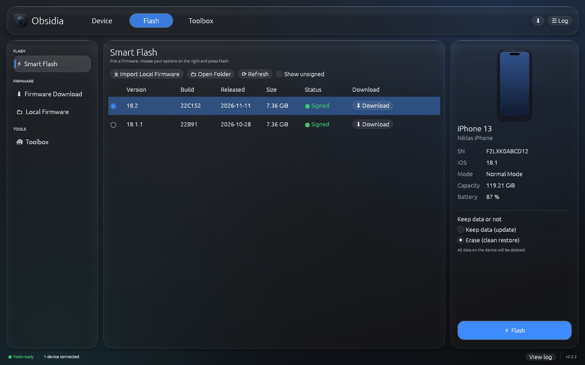

<p align="center">
  
</p>

<h1 align="center">Obsidia</h1>

<p align="center"><em>(formerly MirraFlash)</em></p>

A 3uTools-style firmware flashing tool for **iPhone and iPad**, written in Rust.
Runs on **Windows**, **Linux** and **macOS** - with a modern glass-styled graphical interface and a full CLI.



Obsidia talks to Apple devices through the open-source
[libimobiledevice](https://libimobiledevice.org) stack and fetches firmware metadata
from [ipsw.me](https://ipsw.me).

## Features

- 3uTools-like layout: Device, Flash and Toolbox tabs, firmware list in the middle,
  device and flash options on the right
- Detect iPhones / iPads in **Normal**, **Recovery** and **DFU** mode, with model, OS version,
  capacity, battery, serial, ECID and UDID
- Browse firmwares for the connected device or **any** iPhone / iPad model
- See at a glance which versions Apple **currently signs**
- **Download** IPSW files with progress, resume and SHA-1 verification
- **Flash** with one click: clean restore (erase) or update (keep data)
- Drag & drop a local `.ipsw` onto the window to flash it
- Backup, enter / exit recovery mode
- Live log with progress of every operation

> Apple only allows installing firmwares that are **currently signed**.
> Downgrades to unsigned versions are not possible (unsigned versions can still be downloaded).

## Installation

Installers for every platform are attached to each
[release](https://github.com/LinzN/obsidia/releases).

### Windows

1. Install Apple's USB drivers: the **Apple Devices** app (Microsoft Store) or iTunes.
2. Run `obsidia-<version>-x64.msi`.

The installer ships the libimobiledevice tools, so nothing else is needed. Obsidia shows
up in the start menu and can be removed via *Apps & features*.

> **Smart App Control:** the MSI and the bundled tools are not code-signed yet.
> If Windows' Smart App Control is turned on, it blocks them
> (`os error 4551`). Turn it off under *Windows Security > App & browser control*.

### Linux (Debian / Ubuntu)

```sh
sudo apt install ./obsidia_<version>-1_amd64.deb
```

This pulls in `libimobiledevice-utils`, `irecovery`, `idevicerestore` and `usbmuxd`.
Obsidia appears in the application menu.

### macOS

```sh
brew install libimobiledevice libirecovery idevicerestore
```

Open `obsidia-<version>-macos-arm64.dmg` and drag Obsidia into *Applications*. The app is
not notarized yet: on first launch right-click it and choose *Open*.

## Tool lookup

Obsidia looks for the libimobiledevice tools in this order:

1. the directory in `OBSIDIA_TOOLS`
2. a `tools` folder next to the executable
3. the directory of the executable
4. `PATH`
5. Windows: `C:\msys64\ucrt64\bin`, `C:\msys64\mingw64\bin`; macOS: `/opt/homebrew/bin`, `/usr/local/bin`

## Command line

Without arguments Obsidia opens the GUI. All functions are also available on the CLI:

```sh
obsidia list                          # show connected devices
obsidia firmwares                     # signed firmwares for the connected device
obsidia firmwares -p iPad13,18 --all  # any model, incl. unsigned
obsidia download -v 18.1              # download into the cache
obsidia backup                        # backup into Documents/Obsidia Backups
obsidia flash                         # erase-restore to the latest signed firmware
obsidia flash -v 18.1 --update        # update to a specific version, keep data
obsidia flash -f ~/Downloads/x.ipsw   # local IPSW
obsidia recovery | exit-recovery
```

With several devices connected, select one with `-u <UDID|ECID>`.

Set `OBSIDIA_API` to use an ipsw.me-compatible mirror.

## Build from source

```sh
cargo build --release
```

On Linux the GUI needs the usual X11/Wayland development headers:
`libxkbcommon-dev libwayland-dev libx11-dev libxcursor-dev libxrandr-dev libxi-dev libgl1-mesa-dev`.

Packaging lives in `packaging/` (WiX MSI, `cargo deb`, `.app`/`.dmg`). GitHub Actions
builds all installers on every push and publishes a release whenever the version in
`Cargo.toml` changes.

## Troubleshooting

- **Device not found (Windows):** make sure the Apple Devices app / iTunes is installed and
  the device shows up there.
- **Restore fails:** put the device into **DFU mode** and try again.
- **Activation Lock** still applies after a restore - you need the Apple ID password.

## License

MIT. The bundled libimobiledevice tools are licensed under the LGPL-2.1 / LGPL-3.0
by their respective authors.
